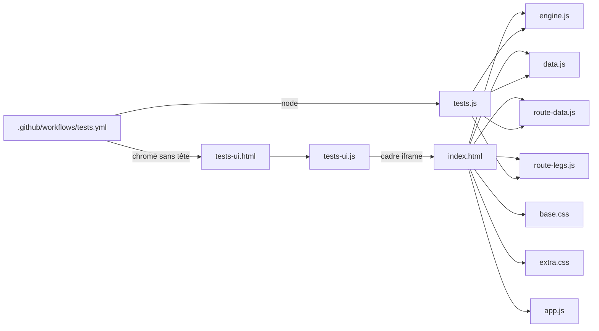
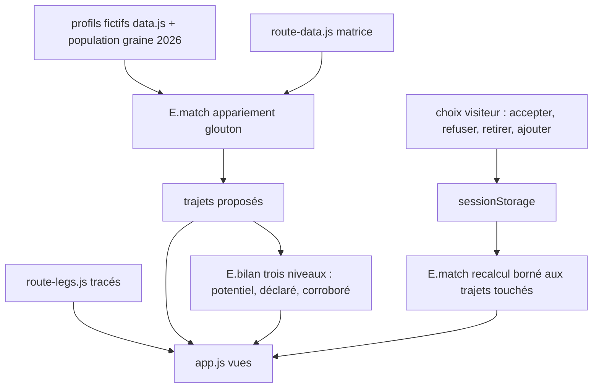
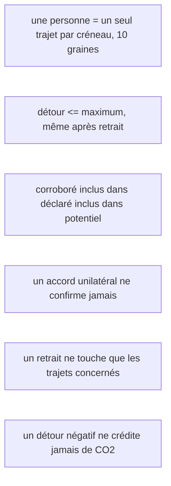

# Carte du code et des dépendances

Carte écrite à la main à partir de la lecture du source (10 novembre 2026), faute d'outil de cartographie automatique disponible. Elle couvre uniquement le code de cette démonstration. GitHub affiche les schémas Mermaid directement.

## Modules

- `data.js` : paramètres par défaut, hypothèses et textes. Aucune donnée réelle.
- `route-data.js` : matrice distances/durées précalculées entre les 31 points fictifs (générée par `precalc.js`, non publié).
- `route-legs.js` : tracés routiers des tronçons de la semaine par défaut (généré par `legs.js`, publié, usage ponctuel documenté dans SOURCES.md).
- `engine.js` : moteur pur et déterministe. Entrées = profils et paramètres, sorties = trajets et bilans. Aucun DOM, aucun réseau.
- `app.js` : rendu des onglets et interactions. Tout l'état volatil est dans `sessionStorage` (clés `tc_dec`, `tc_rec`, `tc_out`), rien de durable.

## Flux de données

## Invariants maintenus par les tests (3328 vérifications)

- Invariants d'interface (tests-ui.html, à chaque push) : parcours complet accepter/refuser/revenir, carte (zoom, liste texte, point déplacé « non calculé »), aléas (retard, absence, ajout tardif), clavier (flèches entre onglets, `aria-selected`).
- Hors périmètre volontairement : pas de backend, pas de comptes, pas de notifications réelles. Voir BILAN.md pour la frontière démonstration / production.
